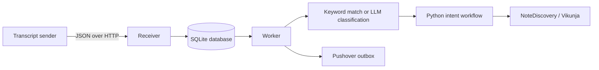

# Koemichi 🧭

**Koemichi is my personal transcript-routing tool**, built around how I use Memo and Journal. It may not be useful as-is for other people, but its receiver and Python workflow structure could be a starting point for building your own tool on top of [Koebako](https://github.com/divin/koebako). The name combines *koe* (声, “voice”) and *michi* (道, “path”): a route for voice notes.

AI tools were used during development.

## 🧭 How it works



The receiver stores transcripts; a separate worker classifies and processes them. Work and notifications are persisted in SQLite and retried as needed. I use NoteDiscovery for my notes. I added read-only search, list, and fetch capabilities so compatible language-model clients can consult the existing vault; deterministic Python workflows still choose paths and handle all writes. The memo specialist extracts only a title; memo bodies and journal entries preserve the raw transcript. The todo specialist creates tasks in my Vikunja inbox through Vikunja's built-in MCP server.

## 🚀 Quick start

1. Copy `example.env` to `.env`; set a reachable NoteDiscovery URL, Vikunja settings (API URL, a `tk_...` token with `mcp:access` scope, and the inbox project id), an OpenAI-compatible LLM URL/model, and Pushover credentials (or set notifications to `off`). See [deployment and configuration](docs/deployment.md).
2. Create a data directory writable by the container's UID/GID `1000:1000`:

   ```sh
   mkdir -p ./data
   sudo chown -R 1000:1000 ./data
   ```

3. Start the services:

   ```sh
   docker compose pull
   docker compose up -d
   docker compose logs -f receiver worker
   ```

The example Compose file maps host port `8001` to container port `8000` on all host interfaces. If authentication is disabled, restrict access with your host firewall to trusted networks. See [deployment and configuration](docs/deployment.md).

## 📥 Transcript API

`POST /transcripts` accepts a versioned JSON payload with a stable `note_id`. The receiver responds `accepted` or `duplicate`; a reused ID with different data is rejected. See the [API reference](docs/api.md) for the payload and authentication behavior.

## 🧠 Intent workflows

Koemichi first checks transcript-opening keywords, then uses an OpenAI-compatible LLM if no keyword matches. Memo, Journal, and Todo have Python workflows; Research is recognized but not implemented and fails explicitly. Memo notes keep the raw transcript under a short descriptive title; Journal transcripts are appended to the file for their recording day; Todo tasks are added to the configured Vikunja inbox via Vikunja's built-in MCP server. See [classification and workflows](docs/workflows.md).

## 🔔 Notifications

Pushover reports accepted transcripts, completed workflows, retries, and terminal failures. Memo and Journal completion notices include the NoteDiscovery path and saved note text; Todo notices include the created Vikunja task title. Messages longer than 1,024 characters are marked as truncated. Transcript and note text are personal data, so see [notifications and privacy](docs/notifications.md).

## 🧪 Development

Use Python 3.12, [`uv`](https://github.com/astral-sh/uv), and [`just`](https://just.systems/man/en/):

```sh
uv sync --dev
just       # Format, lint, and sort imports
just check # Type, format, and lint checks
just test  # Test suite
```
